# Sharm Photographer — Smart Attendance & Management System

> **Master Product & Design System Blueprint — v1.0 (Discovery Draft)**  
> تاريخ التحليل: **18 نوفمبر 2026**  
> المصدر الأساسي: فيديو المستخدم `Download.mp4` (المدة التقريبية: 1:49 دقيقة).  
> الحالة: **خطة تحليل وتصميم، وليست مواصفات نهائية معتمدة أو وصفًا مؤكدًا لنظام يعمل في الإنتاج.**

---

## 0. اقرأ ده الأول — طريقة التعامل مع الوثيقة

الهدف إن الوثيقة تكون **Single Source of Truth** نشتغل منها في تحليل المنتج، ثم UX، ثم UI/Design System، ثم التسليم للتطوير والاختبار.

### رموز الثقة

- **[V] ظاهر بالفيديو:** واجهة، نص أو مثال مصور يمكن تتبعه لتوقيت داخل الفيديو.
- **[I] استنتاج تحليلي:** استنتاج منطقي من أجزاء الفيديو؛ ليس متطلبًا مثبتًا.
- **[P] مقترح:** قرار تصميم/منتج/تقنية يحتاج مراجعة قبل التنفيذ.
- **[Q] سؤال مفتوح:** لا توجد معلومة كافية لحسمه.
- **[D] قرار معتمد:** لا يُستخدم إلا بعد اعتماد صاحب المنتج؛ **لا توجد قرارات معتمدة بعد**.

### حدود المصدر

1. الفيديو خليط من لقطات أشخاص وواجهات توضيحية؛ **لا يثبت وحده** إن كل الوظائف متصلة بنظام واحد يعمل فعليًا.
2. الأرقام والأوقات الظاهرة **أمثلة معروضة** وقد تكون إعدادات قابلة للتغيير، وليست سياسة الشركة المؤكدة.
3. بعض اللقطات صغيرة أو تحتوي نصًا غير مقروء. ما لم يكن النص واضحًا، لا يُستخدم كحقيقة.
4. ده تحليل للجزء **المرئي** من الفيديو؛ لا نعتمد على تفريغ حرفي للصوت.
5. أي جزء غير ظاهر بالتفصيل يتكتب كمقترح، وليس حقيقة مؤكدة.

---

# PART A — Product Discovery & Big Picture

## 1. تعريف المنتج

**[V]** الاسم المعروض: **Sharm Photographer — Attendance & Management System** أو وصف قريب منه في لقطة النهاية، وبداية الفيديو بعنوان **Smart Attendance System**.

**[I]** الفكرة العامة: منصة داخلية لإدارة حضور موظفي شركة (Sharm Photographer) في مواقع العمل والفنادق التابعة، وربط الحضور بالأوقات والموقع الجغرافي، وتحويل الأحداث إلى نقاط إيجابية/جزاءات، مع نظام طلب إجازات ومكافآت وصلاحيات للإدارة. (الاسم هو اسم الشركة فقط، والبرنامج لا يدير جلسات أو أعمال التصوير نهائيًا).

**[P] Product Vision:**

> منصة تشغيل داخلية تساعد العامل على معرفة وضع حضوره ونقاطه وطلباته بوضوح، وتساعد الإدارة على تطبيق قواعد حضور عادلة، قابلة للتدقيق والتعديل بإذن محدد.

### 1.1 حدود النطاق

**ضمن النطاق المبدئي:**

- حسابات المستخدمين والدخول.
- مواقع العمل ونطاقات GPS.
- الجداول والأيام المطلوبة للحضور.
- تسجيل الحضور وتصنيفه حسب الوقت والموقع.
- سجل الحضور والتأخير والغياب.
- Green / Red / Black points والتسويات.
- الخصومات المرتبطة بالجزاءات، إن اعتمدتها السياسة.
- طلب الإجازات وموافقة الإدارة.
- طلب المكافأة بعد بلوغ شروط الأهلية.
- لوحة تشغيل وتحكم للإدارة.
- الإشعارات والتقارير وسجل التغييرات **[P]**.

**مستبعد نهائيًا ودائمًا من النطاق (Permanently Out of Scope) [D - DEC-001]:**

- **إدارة حجوزات العملاء أو الفنادق أو جلسات التصوير:** ظهور عبارات مثل `Hotel Booking System` أو `New Booking` في الفيديو كان مجرد نماذج تجريبية ملغاة؛ أي وظائف حجز أو عملاء أو تصوير أو معدات أو معارض صور مستبعدة نهائيًا ودائمًا من هذا النظام الداخلي.
- **الرواتب وصرفها الفعلي:** النظام يحسب الخصومات والمكافآت ككشوف تسوية قابلة للتصدير، لكن لا يشمل نظام Payroll كامل أو ربط بنكي مباشر.
- **تتبع الموقع المستمر خلال اليوم:** التحقق المكاني يتم لحظيًا عند عمليتي تسجيل الحضور (Check-in) وتسجيل الانصراف (Check-out) عبر GPS فقط [D - DEC-005]؛ لا يوجد أي تتبع مستمر لمسار حركة الموظف على مدار اليوم وهو مستبعد دائمًا.
- **إثبات الهوية بالوجه/البصمة أو جهاز حضور مادي:** الاعتماد حصريًا على تسجيل الموظف من هاتفه المعتمد مع فحص الـ GPS.

## 2. المستخدمون والأدوار

| الدور | وصفه | درجة الثقة | الاحتياج الأساسي |
|---|---|---|---|
| Employee | موظف الشركة الذي يسجل حضوره ويتابع نقاطه وطلباته | [V] | Check-in، الرصيد، الإجازات، المكافآت |
| Owner / Admin | المسؤول الذي يضبط القواعد ويعتمد الطلبات ويعدل النقاط | [V] | تحكم، متابعة، اعتماد، Audit |
| Team Lead / Supervisor | مشرف يراجع فريقًا محددًا | [P] | متابعة الموقع والفريق؛ صلاحيات محددة |
| HR / Operations | مسؤول تشغيلي يدير الجداول والسياسات | [P] | تشغيل يومي وتقارير |
| Finance | يراجع الخصومات والمكافآت للصرف | [P] | كشف تسويات قابل للتصدير |
| System / Automation | خدمة آلية تطبق قواعد الغياب والاحتساب | [I/P] | معالجة مجدولة ومتسقة |

### 2.1 مصفوفة صلاحيات مبدئية — للتأكيد

| الإجراء | Employee | Supervisor [P] | Owner/Admin |
|---|---:|---:|---:|
| مشاهدة حسابه وحضوره | ✓ | ✓ | ✓ |
| تسجيل حضوره لنفسه | ✓ | لنفسه فقط | لنفسه إن كان موظفًا |
| طلب إجازة أو مكافأة | ✓ | ✓ | ✓ |
| مراجعة طلبات موظفين آخرين | — | صلاحية مقيدة | ✓ |
| اعتماد / رفض الإجازة | — | محتمل | ✓ |
| تعديل نقاط شخص | — | — افتراضيًا | ✓ مع سبب وتسجيل |
| إدارة مواقع GPS | — | — | ✓ |
| ضبط أوقات وسياسات النقاط | — | — | ✓ |
| الاطلاع على سجلات الموظفين | حسابه فقط | فريقه فقط | حسب التفويض |
| عرض تقارير مالية | — | لا افتراضيًا | ✓ أو Finance |

**[P] القاعدة الأساسية:** الواجهة لا تُعد وسيلة الحماية؛ التحقق من الصلاحية لازم يتنفذ على الـ API أيضًا.

## 3. System Context — الأطراف والروابط

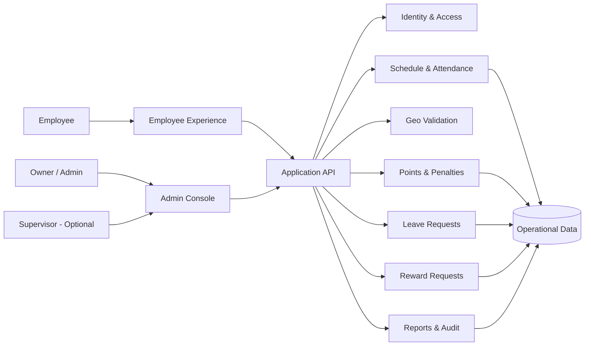

> **ملحوظة:** الرسم **[P] Logical Architecture**، وليس وصفًا لهيكلة Backend ظهرت في الفيديو.

## 4. خريطة الـ Modules وتبعياتها

| ID | Module | الأولوية | يعتمد على | الحد الأدنى للوظائف |
|---|---|---|---|---|
| MOD-01 | Identity & Access | P0 | — | Login, Logout, Session, RBAC |
| MOD-02 | Organization & People | P0 | MOD-01 | Staff profiles, statuses, assignments |
| MOD-03 | Locations & Geofences | P0 | MOD-02 | Worksites, center, radius, GPS policy |
| MOD-04 | Work Schedules | P0 | MOD-02/03 | Workdays, shifts, time windows, holidays |
| MOD-05 | Attendance | P0 | MOD-01/03/04 | Check-in, validation, classification, history |
| MOD-06 | Points & Penalties | P0 | MOD-05 | Green/Red/Black, ledger, conversion, adjustments |
| MOD-07 | Leave Management | P0 | MOD-01/04/05 | Request, approve/reject, absence exemption |
| MOD-08 | Rewards | P1 | MOD-06 | Eligibility, request, approval, payout status |
| MOD-09 | Admin Operations | P0 | All P0 | Dashboard, queues, config, manual actions |
| MOD-10 | Notifications | P1 | Events | In-app, push/email optional, delivery status |
| MOD-11 | Reporting & Export | P1 | MOD-05/06/07/08 | Attendance, deductions, balances, exports |
| MOD-12 | Audit & Security | P0 | All mutations | Actor, action, before/after, timestamp |
| MOD-13 | Integrations | P2 | Stable APIs | HR/Payroll, payout, maps, messaging |

### أولوية التنفيذ

- **P0 / MVP:** بدونها النظام لا يؤدي وظيفته الأساسية أو يفتقد ضمانات لازمة.
- **P1 / بعد الـ MVP مباشرة:** تحسين تشغيل أو قيمة مهمة بعد ضبط الأساس.
- **P2 / لاحقًا:** توسع لا نبدأ به قبل التأكد من الاحتياج.

---

# PART B — Evidence from the Video

## 5. سجل الأدلة البصرية (Video Evidence Ledger)

| التوقيت التقريبي | الشيء الظاهر | الاستنتاج المقبول | الثقة |
|---|---|---|---|
| 00:00 | Intro infographic: GPS / attendance / points / leave / reward / owner control | المحاور الرئيسية للنظام | [V] |
| 00:06–00:09 | Staff Login وCheck In & Points | دخول موظف وواجهة متابعة حضور/نقاط | [V] |
| 00:11–00:14 | Location Verified وخريطة موقع | فحص مكاني قبل الحضور | [V] |
| 00:15–00:21 | إعدادات Normal وLate | تصنيف الحضور حسب فترات زمنية | [V] |
| 00:23–00:26 | Red penalties وMonthly Attendance Deductions | مثال جزاء أحمر × 250 EGP | [V] |
| 00:29–00:31 | Early Check-in 07:00–08:00 وGreen Point | مثال نقطة خضراء مع الحضور المبكر | [V] |
| 00:33–00:36 | Remove -1 على Red late | واجهة استخدام نقطة خضراء لإزالة Red penalty | [V] |
| 00:39–00:42 | Green Reward Progress 0/30 ثم 30 وSend Reward Request | هدف مكافأة 30 نقطة وإرسال طلب | [V] |
| 00:45–00:51 | InstaPay / Vodafone Cash، رقم دفع، 30 Green ≈ $40 ≈ 2,200 EGP | خيارات بيانات الصرف وقيمة مثال | [V] |
| 00:54–00:59 | Close 12:00 PM ورسالة Check-in unavailable | مثال قفل الحضور عند 12 ظهرًا | [V] |
| 01:00–01:03 | Black absence + Black: 1 × 1,000 EGP = 0 EGP | عداد/معادلة ظاهرة لكن حساب الخصم النهائي غير محسوم | [V]+[Q] |
| 01:06–01:09 | Recurring work days / Rules؛ Remove 5 | أيام عمل وقاعدة 5 Green لإزالة Black | [V] |
| 01:12–01:21 | Add/Enter Points مع Reason وApply Points | الإدارة تقدر تسجل نقاط يدويًا مع سبب | [V] |
| 01:24–01:30 | Request Leave، Pending Leave Requests، Approve/Cancel | طلب إجازة واعتماد من الإدارة | [V] |
| 01:33–01:39 | All Leave Requests، Approved Leave → No Absence Penalty | عدم تطبيق الغياب على إجازة معتمدة | [V] |
| 01:39–01:40 | Attendance table: name/time/on time/distance/points | سجل رقابي للحضور | [V] |


> التوقيتات تقريبية ومقصود بها الرجوع للجزء المرئي، وليست تفريغًا لفظيًا للصوت.

## 6. قواعد البزنس المعتمدة والظاهرة

| Rule ID | القاعدة المعتمدة أو المعروضة | الحالة / التفاصيل المعتمدة |
|---|---|---|
| BR-01 | فحص الـ GPS للحضور والانصراف | **[D - DEC-005]** إلزامي للحضور والانصراف مع فحص النطاق الجغرافي. |
| BR-01-EX | استثناءات الـ GPS (تعطل/خارج النطاق) | **[D - DEC-006]** تسجيل غير معطل (Non-blocking) يُسجل التوقيت ويتحول لـ `Pending Review`. |
| BR-01-REV | نقاط المعاملات المعلقة (Pending Review) | **[D - DEC-007]** تجميد النقاط أثناء التعليق؛ وعند الموافقة يُحتسب التصنيف بالتوقيت الأصلي. |
| BR-02 | Early: **07:00–08:00** → Green point | **[D - DEC-003]** الافتراضي المعتمد، قابل للتعديل بالكامل من المدير/الأدمن. |
| BR-03 | Configurable Interval: **08:00–09:00** | **[D - DEC-003]** فترة قابلة للضبط والتصنيف من الإدارة حسب موقع العمل. |
| BR-04 | Normal: **09:00–10:00** | **[D - DEC-003]** الافتراضي المعتمد، حضور في الموعد بدون نقاط أو جزاءات. |
| BR-05 | Late: **10:00–11:00** → Red point | **[D - DEC-003]** الافتراضي المعتمد لتسجيل التأخير والجزاء الأحمر. |
| BR-06 | Configurable Interval: **11:00–12:00** | **[D - DEC-003]** فترة قابلة للضبط والتصنيف من الإدارة. |
| BR-07 | Cutoff time: **12:00 PM** | **[D - DEC-003/004]** موعد قاطع الحضور؛ قابل للضبط. |
| BR-07-POST | الحضور بين Cutoff ونهاية الوردية | **[D - DEC-004]** يُقبل الحضور، الحالة `Present`، وتُمنح `Black Card` مع إشعار فوري. |
| BR-07-END | الحضور بعد نهاية الوردية (Shift End) | **[D - DEC-004]** يُغلق التسجيل الذاتي بالكامل؛ يُحال للمراجعة الإدارية حصريًا. |
| BR-08 | Check-out (تسجيل الانصراف) | **[D - DEC-002]** إلزامي في الـ MVP بتوقيت الخادم وفحص GPS؛ دون جزاءات تلقائية. |
| BR-09 | Red penalty: **250 EGP** في المثال | [V]+[Q] هل المبلغ ثابت أم قابل للتخصيص؟ يحتاج اعتماد مالي. |
| BR-10 | Black penalty: **1000 EGP** | [V]+[Q] تفسير معادلة `1 × 1000 = 0` يحتاج حسم مالي. |
| BR-11 | **1 Green → remove 1 Red** | [V] إمكانية استبدال نقطة خضراء لمحو جزاء أحمر. |
| BR-12 | **5 Green → remove 1 Black** | [V] إمكانية استبدال 5 نقاط خضراء لمحو جزاء أسود. |
| BR-13 | **30 Green → $40** في المثال | [V] عتبة المكافأة ومسار الصرف عبر InstaPay / Vodafone Cash. |
| BR-14 | طلب الإجازات واعتماد الإدارة | [V] الإجازة المعتمدة تمنع تسجيل الغياب. |
| BR-15 | تعديل إداري مع سبب إلزامي | [V]+[D] أي تعديل يدوي يحفظ سببًا وتدقيقًا غير قابل للتلاعب. |

### 6.1 القرارات المحسومة لفجوات الوقت واستثناءات الـ GPS
1. **الجدول الزمني الافتراضي وقابليته للضبط [DEC-003]:** الفترات 08–09 و11–12 تم اعتمادهما كفترات قابلة للتكوين (Configurable) بواسطة Admin/Manager؛ والجدول بالكامل غير مكتوب في الكود برمجياً كقيم ثابتة ويخضع للتعديل وسجل تدقيق كامل.
2. **الحضور بعد موعد الإغلاق [DEC-004]:** الحضور بين 12:00 ونهاية الوردية يُسجل حضورًا فعليًا (Present) مع بطاقة سوداء (Black Card). الحضور بعد نهاية الوردية يُغلق التسجيل الذاتي ويُحال للإدارة.
3. **معالجة تعذر الـ GPS [DEC-006 & DEC-007]:** عدم توفر الموقع أو الخروج عن النطاق لا يمنع الموظف من إرسال العملية؛ تُسجل بتوقيت الخادم وتدخل حالة `Pending Review`، مع تجميد النقاط حتى مراجعة الإدارة، وعند القبول يُطبق التصنيف بالتوقيت الأصلي للحدث.

---

# PART C — Domain Model & Business Logic

## 7. النموذج المفاهيمي (Domain Model)

**[P]** تقسيم الدومين إلى كيانات مستقلة يقلل التعارض بين الحضور والنقاط والإجازات والمكافآت.

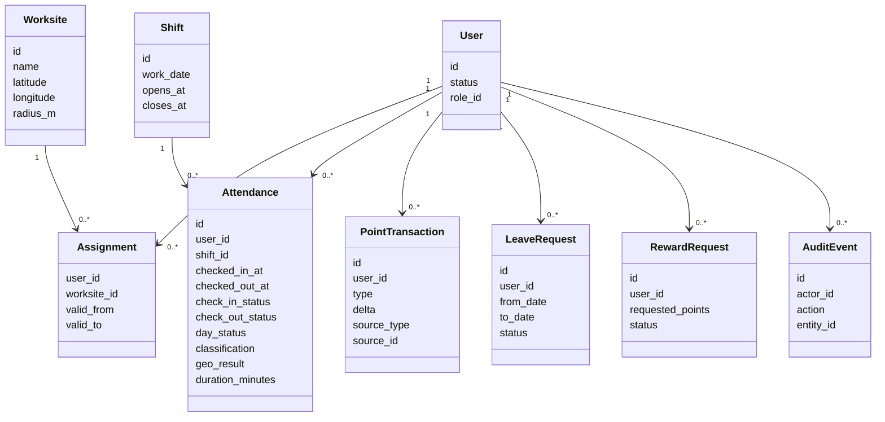

### 7.1 الكيانات المقترحة بالتفصيل

| Entity | حقول أساسية | ملاحظات |
|---|---|---|
| Organization | id, name, timezone, currency | حتى لو شركة واحدة، تحديد timezone وسياسة العمل ضروري |
| User | id, display_name, phone, status, created_at | بيانات الهوية بأقل قدر ممكن |
| Role/Permission | role_id, permission_key, scope | Role Based Access Control |
| EmployeeProfile | user_id, employee_code, team, hire_date | تجنب خلط بيانات الحساب بملف HR |
| Worksite | id, name, lat, lng, radius_m, active | Geofence دائري كمقترح؛ يمكن تغيير الشكل |
| Assignment | user_id, worksite_id, schedule_id, start/end | يسمح بنقل الموظف بين المواقع تاريخيًا |
| ScheduleTemplate | workdays, time_windows, effective_from | نسخ سياسة مع تواريخ صلاحية |
| ShiftOccurrence | id, work_date, start/end, assignment | يوم عمل محدد يمكن تقييمه |
| AttendanceAttempt | time, coordinates, accuracy_m, result_code | حفظ المحاولات الناجحة/الفاشلة بأمان |
| AttendanceRecord | shift_id, employee_id, check_in_at, checked_out_at, status, duration_minutes | سجل الحضور والانصراف المعتمد مع بيانات الوردية والتصنيف |
| PointPolicy | type, amount, conversion, version | قواعد مرتبطة بإصدار policy |
| PointTransaction | signed_delta, reason, source, created_by | Ledger لا يُعدّل رصيده يدويًا |
| PenaltyCase | type, date, monetary_amount, status | سجل الجزاء ومنشئه وسبب إلغائه |
| Redemption | consumed_points, target_case, status | يربط صرف النقاط بالتسوية |
| LeaveRequest | from/to, reason, status, reviewer | التواريخ والقرار والتاريخ الكامل |
| RewardRequest | reward_type, points, payout_method, status | لا تخزن معلومات الدفع أكثر من اللازم |
| Notification | recipient, template, channel, delivery_state | إرسال وإعادة المحاولة |
| AuditEvent | actor, action, entity, before/after, time | سجل غير قابل للتلاعب من واجهة المستخدم |

### 7.2 قواعد سلامة البيانات — [P]

- معرف فريد لكل محاولة/سجل/معاملة.
- الوقت يُخزن بصورة قابلة للمعالجة مع Timezone معروف؛ عرض الوقت المحلي للمستخدم.
- أي تغيير في رصيد النقاط ناتج عن **Transaction** وليس تعديل قيمة `balance` مباشرة.
- حفظ نسخة policy المطبقة على يوم الحضور حتى لا تعيد تغييرات الشهر الجديد احتساب أيام قديمة تلقائيًا.
- منع ازدواج Check-in لنفس الـ Shift من خلال **idempotency** وقيود البيانات.
- الفصل بين **Event date** و**Created at** و**Approved at**؛ خصوصًا في الإجازات والجزاءات.
- لا تحذف السجلات المالية/الرقابية بصمت؛ استخدم عكس القيد `reversal` مع سبب.

## 8. Attendance Engine — محرك الحضور

### 8.1 مسار تسجيل الحضور المعتمد (Check-in Workflow) — [D - DEC-003, 004, 005, 006, 007]

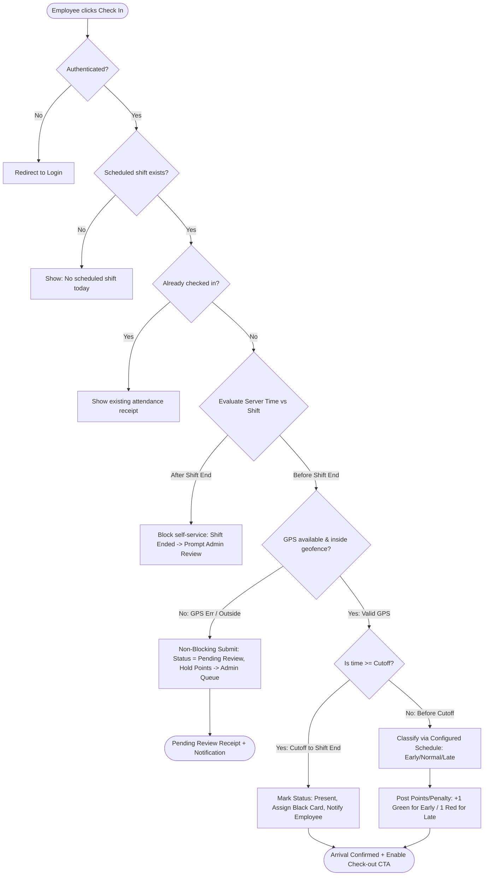

### 8.1.1 مسار تسجيل الانصراف المعتمد (Check-out Workflow) — [D - DEC-002, 005, 006, 007]

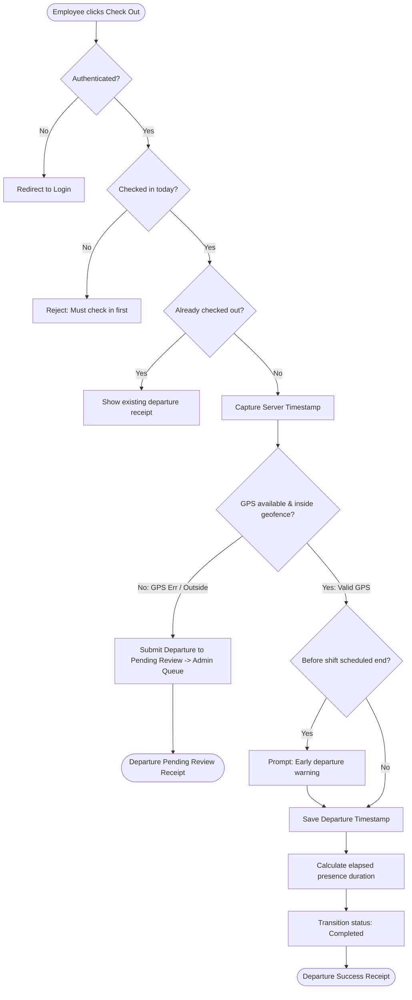

> **قواعد استثنائية معتمدة صارمة:**
> 1. تعذر الـ GPS أو الخروج عن النطاق لا يلغي العملية؛ يُسمح بالإرسال وتدخل المعاملة في `Pending Review` بتوقيت الخادم الأصلي [D - DEC-006].
> 2. أثناء تعليق المعاملة (`Pending Review`) يتم **تجميد النقاط والجزاءات** بالكامل. وعند اعتماد الإدارة لعملية الحضور، يُحتسب التصنيف بالتوقيت الأصلي للحدث. وعند اعتماد الانصراف، يُوثق الانصراف فقط دون توليد أي نقاط حضور [D - DEC-007]. وعند الرفض، يلزم سبب إداري ولا تُمنح أي نقاط، ولا يترتب على الرفض آليًا جزاء أسود بل يخضع لسياسة الغياب المستقلة [DEC-023 OPEN].
> 3. الحضور بين Cutoff ونهاية الوردية يُسجل حضورًا فعليًا (`Present`) مع بطاقة سوداء (`Black Card`). البطاقة السوداء علامة انضباطية وليست غيابًا غير مبرر، ولا تعني تلقائيًا خصمًا ماليًا، ولا تنطبق عليها تلقائيًا قاعدة محو 5 نقاط خضراء الخاصة بغرامة الغياب [D - DEC-004].
> 4. لا تُطبق أي خصومات مالية أو جزاءات نقاط على الانصراف المبكر أو نسيان الانصراف دون موافقة صريحة من صاحب المشروع [DEC-018, DEC-019 OPEN].
> 5. **توصية معمارية (Proposal):** فصل حالات العمليات (`CheckInStatus`, `CheckOutStatus`, `AttendanceDayStatus`) لتجنب تداخل الحالات ومحو حالة مراجعة إحداهما بالأخرى.

### 8.2 حالات الحضور المعتمدة والمقترحة

| Status | المعنى | من يحدده | الأثر على النقاط |
|---|---|---|---|
| not_scheduled | لا توجد وردية هذا اليوم | الجدول | لا نقاط |
| not_open | لم تبدأ نافذة الحضور | الوقت | لا نقاط |
| eligible | يمكن التسجيل الآن | الوقت والجدول | يحدد عند الحضور |
| checked_in_early | حضر مبكرًا | Schedule Engine | +1 Green Point |
| checked_in_normal | حضر في الوقت الطبيعي | Schedule Engine | لا نقاط ولا جزاءات |
| checked_in_late | حضر متأخرًا | Schedule Engine | Red Penalty |
| present_black_card | حضر بعد Cutoff وقبل نهاية الوردية | Rule Engine [D] | حالة Present + Black Card |
| check_in_closed | انتهت نافذة التسجيل الذاتي (بعد نهاية الوردية) | السياسة [D] | يتطلب مراجعة إدارية |
| pending_review | سُجل بتعذر GPS أو خارج النطاق | Exception Pipeline [D] | **تجميد النقاط بالكامل** لحين القرار |
| approved_verified | اعتمدته الإدارة بعد المراجعة | Admin Review [D] | تقييم النقاط بالتوقيت الأصلي |
| rejected_exception | رفضته الإدارة مع سبب إلزامي | Admin Review [D] | صفر نقاط |
| completed | تم الانصراف رسميًا واكتملت الوردية | Check-out Engine | لا جزاءات انصراف |
| completed_early_departure | انصرف قبل نهاية الوردية المقررة | Check-out Engine | توثيقي فقط دون خصم نقاط |
| incomplete | حضر ولم يسجل انصراف حتى إغلاق اليوم | Reconciliation Job | لا جزاء تلقائي (مراجعة إدارة) |
| absent_penalized | غياب كامل دون إجازة أو حضور | Batch Engine | جزاء غياب وفق السياسة |
| excused_leave | إجازة معتمدة تغطي الوردية | Leave Engine | إعفاء كامل من الغياب |
| manually_adjusted | تم التصحيح بواسطة مسؤول مع سبب | Admin + Audit | حسب قيد التعديل الإداري |

### 8.3 جدول الحضور الافتراضي والقابل للتكوين (Configurable Schedule) — [D - DEC-003]

| الفترة الافتراضية | التصنيف الافتراضي | قابلية الضبط بواسطة Admin/Manager |
|---|---|---|
| **07:00 – 08:00** | **Green** (+1 Green Point) | قابلة للتعديل وتغيير التصنيف والوقت |
| **08:00 – 09:00** | **Configurable — Unset** [DEC-022 OPEN] | تظل غير محددة حتى يضبطها المدير لكل موقع عمل عبر لوحة التحكم |
| **09:00 – 10:00** | **Normal** (On-Time، صفر نقاط) | قابلة للتعديل وتغيير التصنيف والوقت |
| **10:00 – 11:00** | **Red** (Red Penalty) | قابلة للتعديل وتغيير التصنيف والوقت |
| **11:00 – 12:00** | **Configurable — Unset** [DEC-022 OPEN] | تظل غير محددة حتى يضبطها المدير لكل موقع عمل عبر لوحة التحكم |
| **12:00** | **Attendance Cutoff** | موعد قاطع الحضور؛ قابل للضبط بالكامل [D - DEC-003] |
| **Configurable End** | **Shift End** | نهاية الوردية الرسمية؛ تغلق الحضور الذاتي بالكامل [D - DEC-004] |

> **قاعدة برمجية ملزمة:** يُحظر برمجة أي جدول زمني كقيم ثابتة (Hardcoded) في الكود البرمجي. جميع الفترات والتصنيفات ومواعيد الإغلاق تُخزن في قاعدة البيانات وتُعدل من لوحة التحكم مع تسجيل كل تعديل بالوقت وهوية المنفذ.

**[P] عند الموافقة على السياسة:** احفظ الفترات كـ intervals متصلة، غير متداخلة، ولكل لحظة حالة واحدة فقط؛ مثل `[start, end)`، مع الاحتفاظ بالفترات غير المعينة كـ Unset تمنع التفعيل التشغيلي حتى اعتمادها من الإدارة [DEC-022].

### 8.4 استثناءات الحضور والانصراف المعتمدة والمقترحة

| Scenario | الاستجابة المعتمدة والمقترحة [D / P] | الأثر على النقاط والجزاءات |
|---|---|---|
| GPS permission denied | تقديم غير معطّل كـ Pending Review مع سبب إلزامي وتسجيل رمز الخطأ [D - DEC-006] | تجميد النقاط والجزاءات بالكامل [D - DEC-007] |
| GPS accuracy ضعيفة | خيار إعادة المحاولة أو التقديم كـ Pending Review مع تسجيل الدقة التقنية [D - DEC-006] | تجميد النقاط والجزاءات بالكامل [D - DEC-007] |
| خارج نطاق العمل (Outside Geofence) | بيان بُعد المسافة مع إتاحة التقديم كـ Pending Review مبرر للإدارة [D - DEC-006] | تجميد النقاط والجزاءات بالكامل [D - DEC-007] |
| بعد Cutoff وقبل نهاية الوردية | تسجيل حضور فعلي والحالة Present مع منح Black Card تنبيهي [D - DEC-004] | لا يُعتبر غيابًا ولا خصم مالي تلقائي [DEC-011/012] |
| بعد نهاية الوردية (After Shift End) | إغلاق التسجيل الذاتي؛ لا يُقبل الحضور إلا عبر مراجعة استثنائية للإدارة [D - DEC-004] | خضوع اليوم لمعالجة الغياب [DEC-024 OPEN] |
| طلب Check-in مرتين | منع التسجيل المكرر وعرض تفاصيل أول تسجيل معتمد [D - DEC-002] | منع مضاعفة النقاط أو التلاعب بالسجلات |
| طلب Check-out مرتين | منع التكرار والاحتفاظ بأول انصراف مسجل رسميًا [D - DEC-002] | لا تأثير على النقاط |
| Check-out بدون Check-in | منع تسجيل الانصراف وعرض تنبيه يلزم الموظف بمراجعة المسؤول [D - DEC-002] | إحالة لـ Incomplete Review |
| نسيان الانصراف بنهاية اليوم | تحويل الوردية إلى Incomplete للمراجعة الإدارية دون جزاء تلقائي [DEC-018 OPEN] | صفر خصومات تلقائية حتى بت الإدارة |
| انصراف مبكر قبل نهاية الوردية | تحذير تأكيدي وتسجيل الانصراف الفعلي توثيقيًا دون جزاء نقاط تلقائي [DEC-019/021] | صفر خصم نقاط حتى اعتماد السياسة |
| موقع مزيف / mock location | Flag فني للمراجعة الإدارية مع تسجيل الإحداثيات [P] | تجميد النقاط كـ Pending Review |
| جهازه وقته غير صحيح | الاعتماد الكامل على توقيت الخادم الموثوق Server Time [D - DEC-002] | تقييم الفترات وفق توقيت الخادم فقط |
| Shift اتغير بعد اليوم | لا يعاد احتساب القديم إلا بعملية معتمدة ومسجلة بسجل Audit [P] | قيد تصحيحي مستقل |
| المستخدم منقول بين موقعين | التحقق من تكليف الموقع الفعال لنفس اليوم [P] | وفق نطاق الموقع الفعال |
| الإجازة تُعتمد متأخرًا | إلغاء جزاء الغياب بـ Reversal وAudit مسجل [DEC-016 OPEN] | استرداد الجزاء دون محو التاريخ |
| يوم عطلة رسمية أو Rest Day | لا غياب ولا جزاء افتراضيًا [P] | صفر نقاط وجزاءات |

### 8.5 Acceptance Criteria مبدئية

- AC-ATT-01: عند المستخدم المصرّح والوردية الصحيحة والموقع المقبول والنافذة المتاحة، ينجح تسجيل واحد فقط ويُسجل بالتوقيت الرسمي للخادم [D - DEC-002].
- AC-ATT-02: خارج Geo zone أو عند تعذر الـ GPS، يُتاح تقديم الطلب غير المعطل كـ Pending Review مع سبب إلزامي؛ وتُجمّد النقاط والجزاءات بالكامل حتى يبت المسؤول بالاعتماد أو الرفض [D - DEC-006, DEC-007].
- AC-ATT-03: كل تسجيل يحمل Timestamp موثوقًا من الخادم، وPolicy Version، وWorksite ID، وClassification المحسوب، وإحداثيات الموقع عند الحضور والانصراف [D - DEC-005].
- AC-ATT-04: لا يمكن أن ينتج عن نفس الحدث أو عمليتين متزامنتين قيدين مكررين للنقاط (Idempotency Enforced).
- AC-ATT-05: لا يُطبّق غياب على يوم تغطيه إجازة معتمدة.
- AC-ATT-06: الفترتان 08:00–09:00 و11:00–12:00 تظلان Unset ولا تُفعلان تشغيليًا قبل ضبطهما واعتمادهما رسميًا من الإدارة [DEC-022 OPEN].
- AC-ATT-07: كل من الحضور والانصراف يلزمان التحقق الجغرافي اللحظي دون أي تتبع مستمر في الخلفية [D - DEC-005].
- AC-ATT-08: الحضور بين موعد الإغلاق ونهاية الوردية يُسجل حالة Present مصحوبة بـ Black Card تنبيهي، بينما بعد نهاية الوردية يُغلق التسجيل الذاتي بالكامل [D - DEC-004].

## 9. Points & Penalties — نظام النقاط

### 9.1 الأنواع المعروضة

| النوع | Trigger الظاهر | أثر ظاهر في الفيديو | الثقة |
|---|---|---|---|
| Green | حضور مبكر 07–08 | +1 Green على سبيل المثال | [V] |
| Red | تأخير / إضافة يدوية | خصم 250 EGP في المثال | [V] |
| Black | غياب بدون إجازة معتمدة | مثال 1,000 EGP، لكن المبلغ الفعلي في لقطة = 0 | [V]+[Q] |

### 9.2 Ledger بدل تعديل الرصيد [P]

بدل `green_balance = 10` كقيمة تُعدّل مباشرة:

```text
PointTransaction
- id: TX-001
- employee_id: EMP-001
- point_type: GREEN
- delta: +1
- source: ATTENDANCE
- source_id: ATT-003
- reason: Early check-in
- effective_at: ...
- created_by: SYSTEM
- policy_version: ...

PointTransaction
- id: TX-002
- employee_id: EMP-001
- point_type: GREEN
- delta: -1
- source: REDEMPTION
- source_id: RED-004
- reason: Remove red penalty
- created_by: EMP-001
```

**حساب الرصيد المقترح:**

`available_green = sum(all committed GREEN deltas) - reserved_green`  
بحيث لا يُحسب الحجز أو الصرف مرتين. الرصيد يجب أن يكون مشتقًا من قيود معروفة.

### 9.3 عمليات التحويل الظاهرة

- **[V]** `1 Green → Remove 1 Red`.
- **[V]** `5 Green → Remove 1 Black`.
- **[V]** مسار مكافأة عند بلوغ 30 Green.

**[P] قواعد تنفيذ التحويل:**

1. يتحقق الخادم من الرصيد المتاح ومن وجود جزاء نشط مطابق.
2. يُحجز/يُخصم عدد النقاط المطلوب **ذرّيًا (atomic)**.
3. يُحوّل الجزاء إلى `waived_by_points`، دون حذفه من التاريخ.
4. إذا كان الجزاء سجل خصمًا ماليًا، يُنشأ Adjustment/Reversal حسب السياسة المعتمدة.
5. يُنشأ Audit Event وReceipt واضح للمستخدم.
6. فشل أي خطوة ⇒ عدم تنفيذ العملية جزئيًا.

### 9.4 حالات الجزاء المقترحة

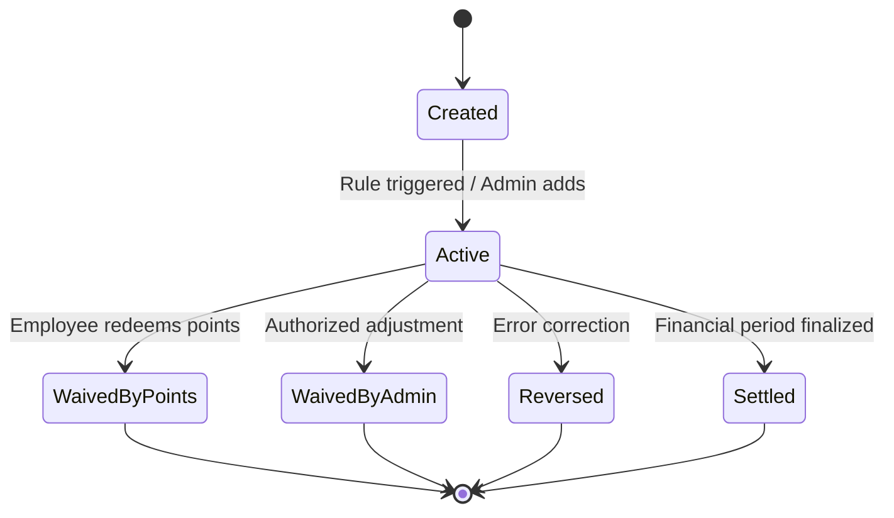

**[Q] نقطة مهمة:** هل `Settled` يمنع الإلغاء؟ وهل إلغاء الجزاء بعد الخصم ينتج رصيدًا مستحقًا؟ لا يمكن اتخاذ قرار مالي بدون صاحب المنتج.

### 9.5 حساب الخصومات [V مثال / P هيكل]

في فيديو المثال:

- Red: `1 × 250 EGP = 250 EGP`.
- Black: تظهر صيغة `1 × 1,000 EGP = 0 EGP`؛ **الحالة غير مفسرة**، لذا لا نحسبها تلقائيًا كـ 1,000 مستحق.
- Red: `2 × 250 EGP = 500 EGP` ظاهر كمثال توضيحي آخر.

**[P] صيغة حساب عامة بعد الحسم:**

`net_deductions = sum(active_penalty_amounts) + adjustments - reversals`

> لازم تحديد هل الخصومات شهرية حسب تاريخ المخالفة أم تاريخ الاعتماد، وهل هناك سقف قانوني/تعاقدي؛ هذا شأن تشغيلي/قانوني يحتاج مراجعة منفصلة.

## 10. Leave Management — الإجازات

### 10.1 User Flow

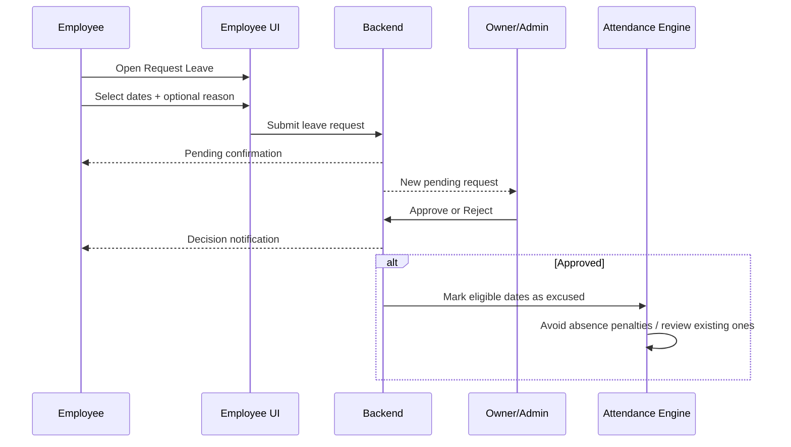

### 10.2 الحالات المقترحة

`draft → submitted/pending → approved | rejected | cancelled`  
مع `expired` فقط لو فيه سبب تشغيلي يستدعي ذلك.

### 10.3 قواعد تشغيل

| ID | القاعدة | حالة |
|---|---|---|
| LEA-01 | الموظف يحدد From/To وسبب اختياري | [V] |
| LEA-02 | الطلب يظهر Pending للإدارة | [V] |
| LEA-03 | يوجد Approve وCancel في واجهة الإدارة | [V] |
| LEA-04 | Approved Leave تمنع غرامة الغياب | [V] |
| LEA-05 | لا يسمح بنطاق تاريخ معكوس | [P] |
| LEA-06 | معالجة التداخل بين طلبات الإجازة | [P] |
| LEA-07 | هل أيام الراحة تُحسب ضمن مدة الإجازة؟ | [Q] |
| LEA-08 | هل يمكن إرسال إجازة بأثر رجعي؟ | [Q] |
| LEA-09 | هل الرفض يحتاج سببًا إلزاميًا؟ | [Q] |
| LEA-10 | إعادة تقييم جزاء سابق عند اعتماد متأخر | [Q/P] |

### 10.4 Acceptance Criteria

- AC-LEA-01: لا يختفي الطلب بعد الإرسال؛ الموظف يرى حالة واضحة.
- AC-LEA-02: كل اعتماد مرتبط بمراجع ووقت قرار.
- AC-LEA-03: لا يتكرر جزاء الغياب على أيام إجازة معتمدة.
- AC-LEA-04: تعديل طلب معتمد يخضع لعملية مراجعة جديدة أو سياسة واضحة.

## 11. Rewards — المكافآت

### 11.1 ما ظهر

- **[V]** Progress `0/30` وواجهة `Send Reward Request`.
- **[V]** عرض `30 Green Points → $40` مع قيمة تقريبية مصورة `2,200 EGP`.
- **[V]** اختيار `InstaPay` أو `Vodafone Cash` وإدخال رقم تحويل.

### 11.2 Proposed Workflow

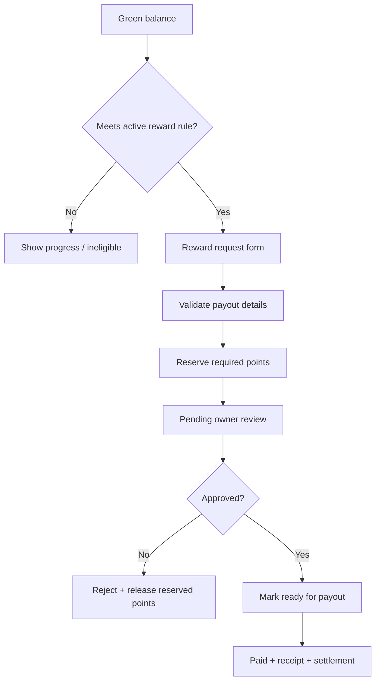

### 11.3 حالات الطلب [P]

`eligible → submitted → under_review → approved → payout_pending → paid`  
مسارات جانبية: `rejected`, `cancelled`, `failed_payout`, `refunded_points` بحسب السياسة.

### 11.4 أسئلة حرجة

1. هل 30 نقطة **تُستهلك** عند طلب المكافأة أم مجرد شرط للأهلية؟
2. هل الاستحقاق **شهري** ويتصفر الرصيد أم تراكمي؟
3. هل قيمة المكافأة بالجنيه ثابتة أم بالدولار مع سعر صرف مرجعي؟ وأي تاريخ يُعتمد؟
4. هل `InstaPay` و`Vodafone Cash` مجرد خيارات لتحويل يدوي أم يوجد API Payment Integration؟
5. ما التصرف إذا تم رفض الطلب بعد حجز النقاط؟
6. هل يمكن استخدام نفس Green points لإلغاء مخالفة وللمكافأة معًا؟ **يجب منع الصرف المزدوج**.

## 12. Admin Operations & Override Policy

**[V]** واجهات Owner تشمل قواعد الأيام/الأوقات، مراجعة الطلبات، تعديل/إضافة نقاط يدويًا، جدول حضور، وبعض بيانات المواقع.

### 12.1 الوظائف المقترحة للإدارة

- Dashboard: ملخص اليوم والحضور والنواقص والطلبات.
- Staff directory: بحث/فلترة/تفاصيل موظف.
- Worksites: تعريف الموقع ونطاقه.
- Schedules: أيام العمل، الورديات، الفترات، تاريخ صلاحية السياسة.
- Attendance review: جدول يومي وتفاصيل Check-in وأسباب الرفض.
- Manual point entry: نوع النقطة، الكمية، سبب إلزامي، أثر متوقع.
- Penalty overrides: إلغاء/تعديل جزاء مع سبب وتأكيد.
- Leave approval queue: Pending + History.
- Reward queue: مراجعة الطلبات وقراراتها وتتبع الصرف.
- Audit log: عرض أي تعديل إداري.
- Reports: تلخيص دوري قابل للتصدير.

### 12.2 سياسة التعديل اليدوي [P]

**لا** يُسمح بـ `edit balance` بلا أثر.

كل عملية Override تحفظ:

`actor_id, target_employee_id, action, before_value, after_value, reason, evidence_reference?, effective_date, timestamp, policy_version`.

قد تحتاج العمليات المالية المهمة **Four-eyes approval** (مراجع ثانٍ)، حسب حجم الفريق وحساسية العمليات.

---

# PART D — IA, Screens & UX

## 13. Information Architecture — Employee

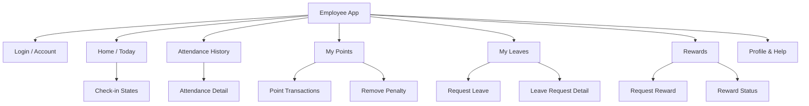

### 13.1 Employee Screen Inventory

| Screen ID | الشاشة | الغرض | أهم المحتوى | الأولوية |
|---|---|---|---|---|
| E-01 | Login | الدخول الآمن | اسم/هاتف + Credential حسب قرار Auth | P0 |
| E-02 | Today Dashboard | ملخص اليوم | حالة الوردية، Check-in / Check-out CTA، وقت، موقع، ملخص نقاط | P0 |
| E-03 | Location Permission | طلب موقع | لماذا نحتاجه + Permission action | P0 |
| E-04 | GPS Validation | فحص المكان | Success/outside/error/retry | P0 |
| E-05 | Attendance Receipt | تأكيد الحضور والانصراف | الوقت، الموقع، التصنيف، نقاط اليوم / مدة الوردية | P0 |
| E-06 | Attendance History | سجل أيام | Date, status, time, filter | P0 |
| E-07 | Attendance Detail | تفاصيل حضور | Shift, location status, rule, event history | P1 |
| E-08 | My Points | الأرصدة | Green/Red/Black + حالات | P0 |
| E-09 | Points Ledger | حركة النقاط | Transaction list + reason + source | P0 |
| E-10 | Penalty Detail | تفسير الجزاء | النوع، السبب، القيمة، وضع التسوية | P0 |
| E-11 | Redeem Points | إلغاء جزاء | Cost, confirmation, success/error | P0 |
| E-12 | Leave List | طلبات الإجازات | Pending/Approved/Rejected | P0 |
| E-13 | Request Leave | تقديم طلب | From/To, reason, submit | P0 |
| E-14 | Leave Detail | متابعة طلب | Reviewer/status/decision | P1 |
| E-15 | Reward Progress | الأهلية | progress, threshold, CTA | P1 |
| E-16 | Reward Request | طلب مكافأة | method, number, summary, confirmation | P1 |
| E-17 | Reward History | مراحل الصرف | Pending/Paid/Rejected | P1 |
| E-18 | Notifications | مركز التنبيهات | attendance/leave/reward events | P1 |
| E-19 | Profile & Settings | بيانات وتفضيلات | الحساب، اللغة، التنبيهات | P1 |
| E-20 | Help / Appeal | مساعدة/اعتراض | مشكلة حضور أو خصم، مرفقات اختيارية | P2 |

## 14. Information Architecture — Admin

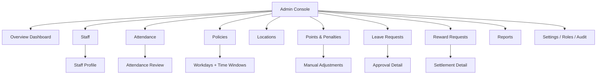

### 14.1 Admin Screen Inventory

| Screen ID | الشاشة | محتوى/أفعال أساسية | الأولوية |
|---|---|---|---|
| A-01 | Admin Login | Authentication + authorized session | P0 |
| A-02 | Overview | Today totals, exceptions, pending requests, latest activity | P0 |
| A-03 | Staff Directory | Table, search, filters, status, worksite | P0 |
| A-04 | Staff Profile | معلومات موظف + سجلات + نقاط + إجازات | P0 |
| A-05 | Worksite List/Editor | Geo center, radius, map, active state | P0 |
| A-06 | Schedule List | Weekday rules, individual assignment, effective dates | P0 |
| A-07 | Policy Editor | Early/Normal/Late/Close, penalty settings, preview | P0 |
| A-08 | Attendance Table | employee/date/in-time/out-time/duration/status/distance/points/filter | P0 |
| A-09 | Attendance Detail | geo/time evidence + classification + action history | P0 |
| A-10 | GPS Exception & Pending Review Queue | مراجعة استثناءات الـ GPS والورديات المعلقة، قبول بتوقيت أصلي / رفض بسبب إلزامي، متابعة الورديات غير المكتملة | P0 |
| A-11 | Points Dashboard | green/red/black totals + balances | P0 |
| A-12 | Manual Points | employee, type, qty, reason, submit confirmation | P0 |
| A-13 | Penalty Case Detail | reason, monetary impact, waive/reverse | P0 |
| A-14 | Leave Queue | request filters, approve/reject | P0 |
| A-15 | Leave Detail | dates, employee, history, decision | P0 |
| A-16 | Reward Queue | eligibility, details, settlement steps | P1 |
| A-17 | Reward Detail | payout method, masked number, statuses | P1 |
| A-18 | Reports | attendance/points/penalties/leave exports | P1 |
| A-19 | Roles & Permissions | permission management | P1 |
| A-20 | Audit Log | searchable admin/system event history | P0 |
| A-21 | Notification Templates | event/copy/channel configuration | P2 |
| A-22 | Organization Settings | currency/timezone/retention | P1 |

## 15. UX Flows المطلوب رسمها في Figma/FigJam

1. **UX-01:** Login → Today → GPS Check → Success.
2. **UX-02:** Location Denied → Permission Help → Retry.
3. **UX-03:** Outside Worksite → Error → Return to site → Retry.
4. **UX-04:** Early → Green Point Posted → Ledger Detail.
5. **UX-05:** Late → Red Penalty → Deduction Detail.
6. **UX-06:** Green Balance → Redeem Red → Updated Ledger.
7. **UX-07:** Green Balance → Redeem Black → Updated Ledger.
8. **UX-08:** Leave Request → Pending → Approved → Attendance Exempt.
9. **UX-09:** Leave Request → Rejected → View Reason.
10. **UX-10:** 30 Green → Reward Request → Under Review → Paid/Rejected.
11. **UX-11:** Admin edits schedule → Preview conflicts → Publish policy.
12. **UX-12:** Admin adds manual point → Confirm → Audit log.
13. **UX-13:** Admin processes absent day → Penalty → Later leave approval → Reconciliation.
14. **UX-14:** Admin opens attendance table → Filter user/date → Inspect row.
15. **UX-15:** Offline/server error/duplicate → Recover without duplicate charge.

### 15.1 كل Flow لازم يوضح

- Actor وGoal وEntry point.
- Preconditions.
- Normal happy path.
- Validation states + business decisions.
- Empty/Error/Loading/Permission states.
- Success confirmation والـ next best action.
- ماذا يحدث في البيانات وبعدها من إشعار/نقاط/جزاء.

## 16. Design Principles الخاصة بالمنتج [P]

1. **Status first:** يعرف الموظف وضع يومه خلال ثوانٍ.
2. **Explain the rule:** أي نقطة/خصم له سبب وتوقيت وقاعدة مطبقة.
3. **Never fake success:** تسجيل الحضور/المكافأة لا يعرض نجاح قبل تأكيد الخادم.
4. **One primary action:** زر رئيسي واضح لكل شاشة/حالة.
5. **No color-only meaning:** Green/Red/Black مع اسم، أيقونة/نص، وليس اللون وحده.
6. **Recoverable errors:** رفض GPS أو انقطاع شبكة له حل أو مسار مراجعة.
7. **Auditability:** كل تعديل يدوي/مالي مفهوم ويمكن تتبعه.
8. **Mobile employee / desktop admin:** تجربة العامل تبدأ بالموبايل، والإدارة مناسبة لجداول الديسكتوب.
9. **Bilingual-ready:** دعم عربي RTL وإنجليزي LTR بشكل صحيح.
10. **Privacy by default:** عرض أقل قدر من بيانات الموقع والدفع.

---

# PART E — Design System Blueprint

## 17. Scope الـ Design System

**هدف الـ DS هنا:** نظام مكونات وتوكنز وتوثيق يخدم **Employee App + Admin Console** بمرجعية واحدة، مع اختلاف Layout وComplexity بينهما.

### 17.1 مستويات النظام

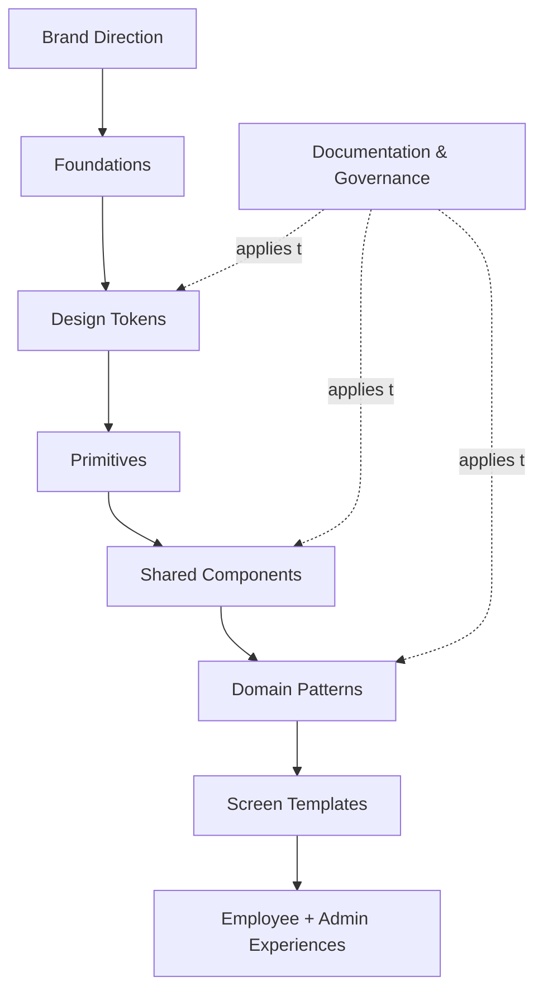

### 17.2 Foundations checklist

| Foundation | المطلوب اتخاذ قرار فيه | المخرجات |
|---|---|---|
| Brand color | هوية الشركة، ألوان الإجراءات، درجة التباين | Palette + usage rules |
| Typography | عربي/إنجليزي، أوزان، line-height | Type scale and text styles |
| Spacing | 4/8-based spacing scale أو مقياس بديل | spacing tokens |
| Sizing | Minimum touch target, controls heights | control sizes |
| Radius | Shape language | radius scale |
| Elevation | Layers / shadows | elevation tokens |
| Borders | widths / semantic separators | border tokens |
| Iconography | stroke/filled, sizes, meaning | icon library rules |
| Grid/Breakpoints | mobile/tablet/desktop, max content width | responsive system |
| Motion | durations, easing, reduced motion | motion tokens |
| Content & UX Writing | عربي/إنجليزي، terminology, currency/date | content guidelines |
| Accessibility | WCAG target, focus, contrast, keyboard | audit checklist |

**[Q] الهوية المرئية:** فيديو الإنفوجرافيك فيه ألوان متعددة، لكن لا يكفي لاشتقاق Brand Tokens نهائية أو قياسات pixel-exact. نحتاج ملفات الشعار/الهوية أو اعتماد Direction.

## 18. Design Tokens Architecture [P]

### 18.1 الطبقات

1. **Primitive:** لون أو قيمة خام بدون معنى منتجي.
2. **Semantic:** معنى مثل `surface`, `text`, `danger`, `success`.
3. **Component:** قيم خاصة بالمكون، مبنية على Semantic.
4. **Domain semantic:** مفاهيم المنتج: points-green/red/black، attendance-status.

**أمثلة أسماء توضيحية فقط — ليست قيم نهائية:**

```json
{
  "color": {
    "primitive": {
      "blue": { "600": "#315FD6" },
      "gray": { "900": "#171B24" }
    },
    "semantic": {
      "text": { "primary": "{color.primitive.gray.900}" },
      "action": { "primary": "{color.primitive.blue.600}" }
    },
    "domain": {
      "point": {
        "green": "{color.semantic.status.success}",
        "red": "{color.semantic.status.danger}",
        "black": "{color.semantic.text.primary}"
      }
    }
  }
}
```

> الـ Hex أعلاه **placeholder** لتوضيح طريقة الـ Token references، وليست ألوان الشركة أو اختيارًا نهائيًا. مرجع `status.success` و`status.danger` يحتاج تعريفًا عند البناء.

### 18.2 مجموعة Tokens المطلوبة

```text
color.primitive.*
color.semantic.surface.*
color.semantic.text.*
color.semantic.border.*
color.semantic.action.*
color.semantic.status.*
color.domain.attendance.*
color.domain.point.*
space.0 ... space.n
size.control.sm/md/lg
font.family.*
font.size.*
font.weight.*
font.lineHeight.*
radius.sm/md/lg/full
border.width.*
elevation.0...n
opacity.*
motion.duration.*
motion.easing.*
breakpoint.*
zIndex.*
```

### 18.3 Token Modes

- **Light / Dark:** Light أولًا إن ده خيار المنتج؛ Dark Mode [P2] ما لم يكن مطلوبًا.
- **LTR / RTL:** اتجاه layout وicon mirroring حسب السياق؛ الاتجاه ليس مجرد Mode ألوان.
- **Density:** Comfortable للموبايل، Compact للجداول عند الإدارة [P].
- **Platform:** Web responsive افتراضي؛ Native app ليس مؤكدًا.

### 18.4 Naming Conventions

- Tokens بالإنجليزي وبأسماء وظيفية مستقرة: `color.semantic.action.primary.bg`.
- Components بصيغة: `Button`, `TextField`, `DataTable`, `StatusBadge`.
- Variants واضحة: `variant=primary|secondary|tertiary`, `size=sm|md|lg`.
- حالات منفصلة: `default`, `hover`, `focus-visible`, `pressed`, `disabled`, `loading`, `error`, `success` حيث تنطبق.
- عدم عمل Component جديد لمجرد اختلاف نص أو أيقونة؛ استخدم Props/Slots.
- عدم توحيد Green/Red/Black كـ Success/Error تلقائيًا؛ دي **نقاط وظيفية** وقد يكون اللون الأسود جزاءً، وليس Dark Theme.

## 19. Component Inventory — Shared Foundations

| المستوى | Component | Variants/States أساسية | أولوية |
|---|---|---|---|
| Primitives | Text, Heading, Icon, Divider | semantic/size/weight | P0 |
| Primitives | Stack, Inline, Grid, Container | spacing/alignment | P0 |
| Actions | Button, IconButton | primary/secondary/danger/loading | P0 |
| Actions | Link, Menu, DropdownMenu | hover/focus/disabled | P0 |
| Forms | TextField, TextArea | normal/error/helper/disabled | P0 |
| Forms | Select, Checkbox, Radio | single/multi/validation | P0 |
| Forms | DatePicker, DateRangePicker | bounds/invalid/locale | P0 |
| Forms | TimeInput, TimeRange | 12/24h, validation | P0 |
| Forms | PhoneInput | country/format/payout-safe | P1 |
| Forms | SearchField, FilterPanel | empty/clear/searching | P0 |
| Feedback | Alert, Toast, InlineMessage | info/success/warning/danger | P0 |
| Feedback | Spinner, Skeleton, Progress | determinate/indeterminate | P0 |
| Feedback | EmptyState, ErrorState | action/retry | P0 |
| Overlays | Modal, Drawer, Popover, Tooltip | safe dismissal, focus trap | P0 |
| Nav | Tabs, SideNav, BottomNav, Breadcrumb | selected/collapsed | P0 |
| Content | Card, KeyValue, Accordion | expanded/compact | P0 |
| Data | DataTable, Pagination, SortHeader | loading/empty/error/selection | P0 |
| Data | StatusBadge, Avatar, Tag | semantic mapping | P0 |
| Data | MetricCard, TrendIndicator | format/positive/negative | P1 |
| Geo | MapContainer, GeofenceMarker | loading/denied/outside/inside | P0 |
| Overlays | ConfirmDialog | irreversible/financial/high-risk | P0 |
| Utilities | CopyValue, MaskedValue | clipboard/sensitive data | P1 |

### 19.1 Domain Components — خاصة بالمنتج

| Domain Component | محتوى | States | Screens |
|---|---|---|---|
| AttendanceStatusCard | اليوم، حالة الوردية، الوقت | before/open/checked/closed/leave | E-02 |
| GPSCheckInButton | Check-in + indicator | ready/requesting/checking/success/error | E-02/E-04 |
| GeoValidationCard | الموقع والمسافة/الدقة | inside/outside/unknown | E-04/A-09 |
| ScheduleWindowCard | Early/Normal/Late/Close | upcoming/current/past | E-02/A-07 |
| AttendanceTimeline | تسلسل أحداث اليوم | event/adjustment | E-07/A-09 |
| PointBalanceCard | Green/Red/Black | empty/nonzero/updated | E-08/A-11 |
| PointLedgerRow | النوع، العدد، السبب، التاريخ | credit/debit/reversal | E-09 |
| PenaltyCard | نوع/مبلغ/حالة/إزالة | active/waived/reversed | E-10/A-13 |
| RedeemPointsDialog | تكلفة + نتيجة | eligible/insufficient/confirm/success | E-11 |
| LeaveRequestCard | المدة والسبب والحالة | pending/approved/rejected | E-12/A-14 |
| LeaveDecisionPanel | approve/reject + reason | submitting/success/error | A-15 |
| RewardProgressCard | points / threshold | locked/eligible/completed | E-15 |
| RewardMethodSelector | InstaPay/Vodafone Cash | selected/invalid | E-16 |
| RewardStatusStepper | حالة الطلب | pending/approved/paid/rejected | E-17/A-17 |
| ManualAdjustmentForm | موظف، نوع، كمية، سبب | draft/invalid/submit/confirmed | A-12 |
| PolicyConflictPanel | التداخل/الفجوات الزمنية | warning/blocker/resolved | A-07 |
| AttendanceDataGrid | تفاصيل وأدلة الحضور | filter/sort/row/detail | A-08 |
| AuditTrailList | وقت، منفّذ، تغيير | searchable/detail | A-20 |

## 20. Component Anatomy & API — أمثلة

### 20.1 Button Anatomy

`Container + Label + Optional Leading Icon + Optional Trailing Icon + Focus Ring + Loading Indicator`

**Props:** `variant`, `size`, `disabled`, `loading`, `icon`, `onClick`.  
**Rules:** لا تستخدم اللون وحده للتعبير عن الخطر؛ تأكيد قبل أي عملية خصم/إلغاء لا يمكن استرجاعها بسهولة.

### 20.2 Status Badge Anatomy

`Icon/Shape + Label + Semantic Tone`.

**Mapping مقترح:**

| Domain status | النص | Tone | ملاحظة |
|---|---|---|---|
| checked_in_normal | On time / في الموعد | success/neutral حسب قرار UX | ليس بالضرورة Green Point |
| checked_in_early | Early / مبكر | positive | يحصل على Green Point حسب القاعدة |
| checked_in_late | Late / متأخر | warning/danger | يوضح Red penalty منفصلًا |
| absent_penalized | Absent / غائب | danger | يذكر الجزاء إن وجد |
| excused_leave | Approved leave / إجازة معتمدة | info/success | لا Black penalty |
| pending | Pending / قيد المراجعة | warning/neutral | يستخدم للطلبات |
| paid | Paid / تم الصرف | success | يعرض إثبات/تاريخ إن وجد |

### 20.3 DataTable Requirements

- Sort + filter + search + pagination/virtualization إن احتاج حجم البيانات.
- Alignment مناسب للأرقام والتواريخ.
- Row detail وليس حشر كل المعلومات في الجدول.
- Sticky header عند الحاجة فقط.
- Empty/Loading/Error states.
- Keyboard navigation وإعلانات Screen Reader.
- تصدير بحدود الصلاحية.

### 20.4 Form Rules

- Label دائمًا ظاهر؛ Placeholder ليس بديلًا عن Label.
- أخطاء الحقول بجوارها مع نص واضح.
- لا تعتمد على Toast وحده لتأكيد Submission مالي.
- Confirmation Dialog قبل إرسال تعديل بنقاط/خصومات.
- حقل السبب يكون **Required** عند العمليات الإدارية ذات الأثر المالي [P].

## 21. Component States Matrix

| Component | Default | Hover/Focus | Loading | Disabled | Error | Success | Empty |
|---|---:|---:|---:|---:|---:|---:|---:|
| Check-in CTA | ✓ | ✓ | ✓ | ✓ | ✓ | ✓ | — |
| TextField | ✓ | ✓ | — | ✓ | ✓ | ✓ | — |
| DateRangePicker | ✓ | ✓ | — | ✓ | ✓ | ✓ | — |
| Reward Request | ✓ | ✓ | ✓ | ✓ | ✓ | ✓ | — |
| Points Card | ✓ | ✓ | ✓ | — | ✓ | — | ✓ |
| Leave Queue | ✓ | ✓ | ✓ | — | ✓ | ✓ | ✓ |
| Admin DataTable | ✓ | ✓ | ✓ | — | ✓ | — | ✓ |
| Geo Validation | ✓ | — | ✓ | — | ✓ | ✓ | — |

## 22. Accessibility & Localization Quality Bar [P]

- استهداف **WCAG 2.2 AA** كمعيار تصميم/اختبار مستهدف، يحتاج اختبار فعلي ولا نفترض الالتزام التلقائي.
- Keyboard-only flows للإدارة؛ `Tab`, `Enter`, `Esc`, focus order.
- Focus indicator واضح، Contrast للنصوص والأزرار، Target size مناسب للمس.
- تدفق RTL حقيقي مع أيقونات Directional mirrors حيث يلزم.
- تواريخ واضحة مثل `28 Sep 2026` أو `٢٨ سبتمبر ٢٠٢٦` مع سياسة صياغة موحدة.
- جملة `1 Green Point removes 1 Red Penalty` تكون متاحة نصيًا، مش بالألوان فقط.
- حفظ العملة الأساسية (`EGP`) دون الخلط مع `USD` في شاشة المكافأة.
- لا تعرض بيانات الدفع كاملة في List أو إشعار؛ استخدم Masking.
- احترام `prefers-reduced-motion` إن كان Web.

## 23. Figma File Architecture [P]

```text
00 — Discovery & Product
    ├─ Product map
    ├─ Evidence & assumptions
    ├─ Personas / Jobs to be done
    ├─ Business rules
    └─ User flows

01 — Foundations
    ├─ Brand (draft)
    ├─ Color primitives
    ├─ Semantic color tokens
    ├─ Typography
    ├─ Spacing, sizing, radius
    ├─ Grids / breakpoints
    ├─ Icons
    └─ Accessibility

02 — Components — Core
    ├─ Actions
    ├─ Forms
    ├─ Navigation
    ├─ Feedback
    ├─ Data display
    └─ Overlays

03 — Components — Domain
    ├─ Attendance
    ├─ Points & penalties
    ├─ Leaves
    ├─ Rewards
    └─ Admin operations

04 — Patterns & Templates
    ├─ Employee mobile templates
    ├─ Admin desktop templates
    ├─ Forms and approvals
    └─ Error/empty/permission patterns

05 — Employee Experience
    ├─ Happy paths
    ├─ Alternate paths
    └─ Error/loading/empty/permission states

06 — Admin Experience
    ├─ Dashboards
    ├─ Tables & filters
    ├─ Workflow queues
    └─ Settings & policies

07 — Prototypes & Handoff
    ├─ Approved flows
    ├─ Spec annotations
    ├─ Responsive behavior
    └─ QA / Design review

99 — Archive / Deprecated
```

### 23.1 قواعد تنظيم المكتبات

- Foundations & Core Components منفصلة عن Product Screens.
- كل Component له: anatomy، usage، variants، states، do/don't، content، accessibility.
- Naming واضح ومتسق بين Figma وCode.
- استخدام Auto Layout، Variables وModes بحسب متطلبات الأدوات المتاحة.
- Single component owner ومسار Contribution/Review.

## 24. Documentation Template لكل Component

```md
# Component: <Name>

## Purpose
Why this component exists.

## Anatomy
Slots, content, interactions.

## Variants
Variants and size matrix.

## States
Default, hover, focus, disabled, loading, error, success.

## Behavior
Keyboard, pointer, touch, async behavior.

## Content
Labels, helper copy, localization.

## Accessibility
Semantics, keyboard, ARIA, contrast, screen-reader behavior.

## Responsive
Mobile, tablet, desktop behavior.

## Do / Don't
Examples.

## Tokens Used
Primitive > Semantic > Component mapping.

## Implementation Contract
Props, events, state constraints, test cases.

## Changelog
Version and migration notes.
```

---

# PART F — System Architecture & Delivery Contracts

## 25. Proposed Technical Layers (Technology-neutral)

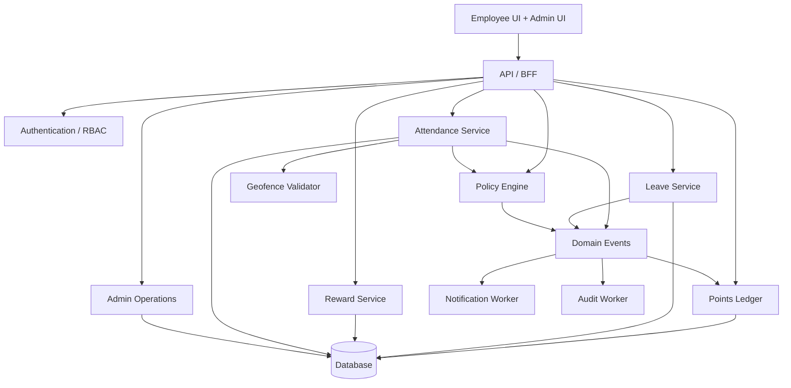

**[P]** ده فصل منطقي؛ ممكن يتنفذ بـ **modular monolith** في البداية بدل Microservices، طالما العقود واضحة. اختيار Framework/DB/Hosting مؤجل لما نحدد حجم الفريق والمنصة والتكلفة.

## 26. Proposed API Contracts (Conceptual)

> أسماء الـ endpoints أمثلة تعاقدية؛ ليست API حقيقية من الفيديو.

| HTTP | Endpoint | Actor | الغرض |
|---|---|---|---|
| POST | `/auth/login` | Public | دخول آمن |
| GET | `/me` | Employee | بيانات المستخدم وصلاحياته |
| GET | `/me/today` | Employee | حالة الوردية والحضور |
| POST | `/attendance/check-in` | Employee | إرسال إحداثيات/دقة وفحص حضور |
| GET | `/attendance/history` | Employee | سجل خاص بالمستخدم |
| GET | `/points/summary` | Employee | أرصدة النقاط |
| GET | `/points/ledger` | Employee | الحركات |
| POST | `/points/redemptions` | Employee | طلب إزالة جزاء بنقاط |
| POST | `/leave-requests` | Employee | إرسال إجازة |
| GET | `/leave-requests` | Employee/Admin | قائمة حسب الصلاحية |
| POST | `/admin/leave-requests/{id}/decision` | Admin | اعتماد/رفض |
| POST | `/reward-requests` | Employee | طلب مكافأة |
| GET | `/reward-requests` | Employee/Admin | تاريخ/قائمة |
| POST | `/admin/points/adjustments` | Admin | تعديل نقاط مع سبب |
| GET | `/admin/attendance` | Admin | جداول الحضور |
| PUT | `/admin/worksites/{id}` | Admin | تعديل موقع |
| POST | `/admin/policies` | Admin | إنشاء/نشر إصدار Policy |
| GET | `/admin/audit` | Admin | مراجعة التغييرات |

### 26.1 شكل نتيجة Check-in المقترحة

```json
{
  "attendance_id": "ATT-EXAMPLE-001",
  "result": "checked_in",
  "classification": "early",
  "checked_in_at": "2026-09-28T07:30:00+02:00",
  "worksite": { "id": "SITE-1", "name": "Example Worksite" },
  "geo_validation": { "status": "inside", "accuracy_m": 20 },
  "point_effect": { "type": "green", "delta": 1 },
  "policy_version": "example-v1"
}
```

**كل البيانات في المثال افتراضية لغرض شرح الـ Schema، وليست سجل موظف فعلي.**

## 27. Event Catalog [P]

| Event | Producer | Consumers | Trigger |
|---|---|---|---|
| `attendance.checked_in` | Attendance | Points, Notifications, Audit | حضور مؤكد |
| `attendance.checked_out` | Attendance | Notifications, Audit, Admin Monitoring | انصراف مؤكد |
| `attendance.pending_review_created` | Attendance | Admin Queue, Audit | إحالة معاملة حضور/انصراف لتعذر GPS أو خروج عن النطاق |
| `attendance.exception_approved` | Admin Operations | Points, Attendance, Audit | اعتماد معاملة معلقة وتقييم نقاطها بالتوقيت الأصلي |
| `attendance.exception_rejected` | Admin Operations | Attendance, Notifications, Audit | رفض معاملة معلقة مع تسجيل سبب إلزامي |
| `attendance.incomplete_flagged` | Scheduler | Admin Queue, Audit | رصد وردية غير مكتملة (نسيان انصراف) |
| `attendance.rejected` | Attendance | Audit/Monitoring | محاولة غير مقبولة |
| `attendance.day_closed` | Scheduler | Absence evaluator | إغلاق يوم العمل |
| `absence.detected` | Attendance | Penalties, Audit | غياب بعد شروط الحسم |
| `points.posted` | Points | UI notification, reporting | قيد نقاط |
| `penalty.created` | Penalty | UI notification, reports | جزاء جديد |
| `penalty.waived` | Penalty | Points, reports | إلغاء جزاء |
| `leave.submitted` | Leave | Admin queue | طلب جديد |
| `leave.approved` | Leave | Attendance, Notifications | اعتماد |
| `reward.submitted` | Reward | Admin queue | طلب مكافأة |
| `reward.paid` | Reward/Finance | Points, Notifications | صرف مثبت |
| `policy.published` | Admin | All engines | سياسة جديدة سارية |

**[P]** كل Consumer يجب أن يتعامل مع الأحداث المكررة safely، خصوصًا النقاط والخصومات.

## 28. Security, Privacy & Operational Requirements [P]

### Security

- Authentication آمن، جلسات محددة العمر، حماية محاولات الدخول المتكررة.
- RBAC + resource-level authorization، خصوصًا سجلات موظف آخر.
- Server-side time وidempotency وrate limit لعمليات Check-in/Redemption.
- عدم الثقة في إحداثيات الجهاز كدليل غير قابل للتزوير؛ GPS يعرض احتمالات ودقة.
- تشفير أثناء النقل وفي التخزين حسب حساسية البيانات.
- Audit log لأي تعديل في السياسات والنقاط والطلبات.
- عدم تضمين بيانات الموظفين الحساسة في Analytics أو Error Logs.

### Privacy

- جمع موقع العامل فقط في سياق الحاجة الوظيفية المعلنة.
- عرض سياسة واضحة لاستخدام الموقع والاحتفاظ به.
- تحديد retention للبيانات والإحداثيات والصور إن أُضيفت لاحقًا.
- تقليل بيانات Payout وMasking في الواجهات.
- تحديد من يرى إحداثيات Check-in الدقيقة.

### Reliability

- رصد فشل check-in وlatency وerror rates.
- Backups، خطة استعادة، ومراقبة Scheduled Jobs.
- سياسة retry لا تخلق نقاطًا مزدوجة.
- Audit على تغييرات الـ Policy Version والتطبيق الفعلي.
- تزامن واضح بين لوحة الإدارة وجهاز الموظف.

### Non-functional targets — غير محددة رقميًا

لا نضع SLA أو زمن استجابة أو معدل مستخدمين متخيل. يتم تثبيت الأرقام بعد معرفة حجم المستخدمين، شروط التشغيل، والميزانية.

---

# PART G — Roadmap / Work Breakdown

## 29. خطة التنفيذ المقترحة — مراحل ببوابات موافقة

> **من غير تقدير أسابيع أو تكلفة الآن.** المدة تعتمد على الفريق والمنصة ونطاق الـ MVP. كل مرحلة لها Deliverables وExit Criteria.

### Phase 0 — Evidence & Alignment

**Tasks**

- [ ] تحويل فيديو المرجع إلى Evidence Board مع Timecodes.
- [x] حسم نطاق المنتج: Attendance & Workforce Management داخلي فقط، واستبعاد دائم ونهائي لأي حجز جلسات أو وظائف تصوير [D - DEC-001].
- [ ] تأكيد المستخدمين والأدوار والصلاحيات.
- [ ] توثيق جميع قواعد النقاط والأوقات والخصومات والمكافآت.
- [ ] تحديد قواعد أيام الراحة، العطلات، الموقع، والتأخير.
- [ ] اعتماد تعريف MVP.

**Deliverables:** Scope v1، Evidence Ledger، Decision Log، Product Glossary، Prioritized Backlog.  
**Exit:** لا توجد فجوة حرجة في وقت الحضور أو منطق احتساب الجزاءات.

### Phase 1 — Product Architecture

- [ ] Context diagram.
- [ ] Entity relationships + lifecycle states.
- [ ] Roles & permissions matrix.
- [ ] Policy versioning strategy.
- [ ] Event flows ومبدأ Audit.
- [ ] حالات الاستثناء واسترجاع الأخطاء.

**Deliverables:** Domain Model، State Diagrams، Architecture v1، Data Dictionary.  
**Exit:** كل User Action له Data Effect معلوم وكل قرار حساس له صلاحية واضحة.

### Phase 2 — UX Foundation

- [ ] Information Architecture للموظف والإدارة.
- [ ] رسم User Journeys وCritical Flows.
- [ ] تعريف حالات Loading/Empty/Error/Permission.
- [ ] Low-fidelity wireframes لأهم P0.
- [ ] مراجعة قواعد الحضور والمكافآت مباشرة على الـ Wireframes.

**Deliverables:** IA Map، Flow Maps، Wireframes، UX Acceptance Criteria.  
**Exit:** يستطيع المراجع متابعة الحضور/الإجازة/الجزاء من البداية للنهاية.

### Phase 3 — Design System Foundations

- [ ] تثبيت Brand Direction.
- [ ] Primitive + Semantic Tokens.
- [ ] Typography عربي/إنجليزي.
- [ ] Spacing, radius, elevation, grids, icons.
- [ ] Responsive strategy وRTL.
- [ ] Accessibility foundations.

**Deliverables:** Figma Foundations Library، Token Spec، Content Guidelines.  
**Exit:** لا توجد قيم أساسية مهمة Hardcoded داخل أول مجموعة Screens.

### Phase 4 — Core Component Library

- [ ] Button, inputs, date/time, selects.
- [ ] Feedback, nav, dialogs, badges.
- [ ] DataTable وأساسيات الإدارة.
- [ ] Variants + states + documentation.
- [ ] Design QA + accessibility review.

**Deliverables:** Core Components Library + Usage Docs.  
**Exit:** شاشات P0 ممكن تتبني بدون إعادة رسم العناصر المشتركة.

### Phase 5 — Domain Components & Screen UI

- [ ] Attendance states/components.
- [ ] Point balance / ledger / penalties.
- [ ] Leave forms & review queue.
- [ ] Admin schedules & policies.
- [ ] Rewards components حسب أولويات النطاق.
- [ ] Responsive UI + bilingual-ready specs.

**Deliverables:** Employee UI، Admin UI، Component Inventory محدث.  
**Exit:** كل P0 Screen لها Desktop/Mobile behavior وError States.

### Phase 6 — Prototype, Validation & Handoff

- [ ] Prototypes لأهم User Flows.
- [ ] مراجعة المستخدمين الفعليين وسياسة البزنس.
- [ ] Handoff للـ Dev: states, validations, APIs, tokens.
- [ ] Design QA checklist + edge cases.
- [ ] إصلاح أي تناقض بين Design وRule Engine.

**Deliverables:** Approved Prototype، Handoff Pack، Test Scenarios.  
**Exit:** لا توجد حالات حرجة بدون قرار أو شاشة أو رسالة خطأ.

### Phase 7 — Build & Verification (لو التطوير داخل النطاق)

- [ ] إعداد Backend/Data/API/RBAC.
- [ ] Attendance + GPS policy implementation.
- [ ] Points ledger + absence reconciliation.
- [ ] Leave approval workflow.
- [ ] Admin console/employee UI.
- [ ] Rewards workflow إن دخل MVP/P1.
- [ ] Integration/E2E/Accessibility/Security tests.
- [ ] Pilot داخلي على موقع واحد وسياسة واحدة.
- [ ] Rollout ومراقبة ومراجعة قرارات التشغيل.

**Deliverables:** Tested Release، Runbook، Monitoring، Incident / Rollback Plan.  
**Exit:** سيناريوهات الحضور والنقاط والإجازات والأخطاء الأساسية ناجحة وموافق عليها.

## 30. Dependency Graph — ترتيب الشغل

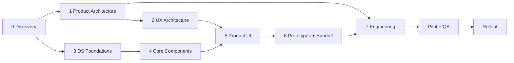

## 31. الأولويات التنفيذية حسب قيمة المنتج

| Priority | Epic | لماذا الآن؟ | أهم شرط قبل البدء |
|---|---|---|---|
| P0 | Identity & RBAC | حد أساسي للأمن | تحديد Role Matrix |
| P0 | Worksites & Schedules | أساس الحضور | حسم أوقات ونطاقات GPS |
| P0 | Check-in | Core user action | قواعد الحالات والاستثناءات |
| P0 | Absence & Points | القيمة الأساسية للمنتج | قواعد مالية معتمدة |
| P0 | Leave approvals | يمنع غياب غير مستحق | سياسة تعارض/اعتماد |
| P0 | Admin review & Audit | التحكم والمساءلة | صلاحيات وإجراءات Override |
| P0 | DS Foundations + Core | توحيد التصميم | IA + UX flows الأساسية |
| P1 | Rewards | قيمة تحفيزية | الاستحقاق والصرف المعتمد |
| P1 | Reports & Notifications | تشغيل أفضل | بيانات وEvents مستقرة |
| P2 | Integrations/Advanced analytics | توسع | ثبات MVP واحتياج مثبت |

## 32. Product Backlog — قائمة قصص مستخدم أولية

| ID | Story | Acceptance — Minimum | Priority |
|---|---|---|---|
| US-001 | كموظف أريد الدخول لحسابي | أرى بياناتي فقط | P0 |
| US-002 | كموظف أريد معرفة موقفي اليوم وأزرار الحضور والانصراف | حالة يوم ووقت وأزرار Check-in وCheck-out واضحة | P0 |
| US-003 | كموظف أريد تسجيل حضوري (Check-in) | التحقق من الموقع والوقت وتأكيد الحضور وتوليد النقاط إن انطبقت | P0 |
| US-004 | كموظف أريد تسجيل انصرافي (Check-out) | تسجيل وقت الانصراف بدقة وحساب مدة التواجد دون جزاءات غير معتمدة | P0 |
| US-005 | كموظف أريد فهم سبب رفض الحضور أو الانصراف | رسالة سبب واضحة ومسار معالجة دون عقوبات وهمية | P0 |
| US-006 | كموظف أريد رؤية سجل الحضور والانصراف | عرض أوقات الدخول والخروج والمدد وحالات الوردية | P0 |
| US-007 | كموظف أريد معرفة نقاطي | Green/Red/Black وحركة الرصيد | P0 |
| US-008 | كموظف أريد إزالة جزاء بنقاطي | التحقق من الأهلية ومنع الصرف المزدوج | P0 |
| US-009 | كموظف أريد طلب إجازة | مدى تواريخ + تأكيد + حالة | P0 |
| US-010 | كمدير أريد مراجعة إجازة | قبول/رفض مع أثر على الغياب | P0 |
| US-011 | كمدير أريد ضبط أوقات الحضور ونهاية الوردية | فترات بلا فجوات غير مقصودة + version | P0 |
| US-012 | كمدير أريد ضبط مواقع العمل | Geozone وسياسة دقة | P0 |
| US-013 | كمدير أريد تعديل نقاط أو تصحيح سجل حضور بسبب | تدقيق وسجل تغيير وسبب إلزامي دون جزاءات تلقائية | P0 |
| US-014 | كمدير أريد كشف الحضور والانصراف اليومي | عرض أوقات الدخول والخروج والورديات غير المكتملة والفلترة | P0 |
| US-015 | كمدير أريد مراجعة الورديات غير المكتملة (نسيان الانصراف) | قائمة الورديات المفتوحة وخيارات التصحيح دون خصم تلقائي | P0 |
| US-016 | كموظف أريد طلب مكافأة | شرط استحقاق + مراحل الطلب | P1 |
| US-017 | كمدير أريد متابعة المكافآت | مراجعة + حالة صرف | P1 |
| US-018 | كمسؤول أريد تقارير شهرية شاملة | أرقام حضور وساعات وخصومات قابلة للتصدير | P1 |
| US-019 | كموظف أريد إخطار قرار الإجازة | حالة واضحة داخل المنتج | P1 |
| US-020 | كمراجع أريد سجل تعديل كامل | من غيّر ماذا ومتى ولماذا | P0 |

## 33. Test Scenarios — تغطية المخاطر

| Test ID | السيناريو | المتوقع |
|---|---|---|
| T-001 | داخل Geofence ووقت Early | نجاح + تصنيف Early + أثر نقاط مرة واحدة |
| T-002 | داخل Geofence ووقت Normal | نجاح + Normal، بدون Green إلا لو Rule تنص |
| T-003 | وقت Late | Late + جزاء وفق Policy Version |
| T-004 | 08:30 قبل حسم قواعد الوقت | **يمنع الإطلاق** لأن القاعدة غير محسومة |
| T-005 | 11:30 قبل حسم قواعد الوقت | **يمنع الإطلاق** لأن القاعدة غير محسومة |
| T-006 | Check-in عند Close boundary | نتيجة واحدة محددة حسب boundary rule |
| T-007 | Location Permission Denied | رفض مفهوم دون Check-in وهمي |
| T-008 | Outside Geofence | لا حضور + مسار retry |
| T-009 | Double-click + request retry | سجل واحد ونقاط واحدة |
| T-010 | جهاز وقتُه غير صحيح | استخدام وقت الخادم |
| T-011 | Approved Leave قبل انتهاء اليوم | لا Black absence |
| T-012 | Leave Approved after penalty | Reconciliation حسب قرار السياسة |
| T-013 | Green balance أقل من تكلفة إزالة جزاء | Disable + رسالة سبب |
| T-014 | Green تُستخدم مرتين بالتزامن | عملية واحدة ناجحة فقط |
| T-015 | Admin manual adjustment | سجل Audit مكتمل |
| T-016 | تعديل Policy | التأثير يبدأ من التاريخ المعتمد ولا يغير التاريخ صمتًا |
| T-017 | Reward request double submit | طلب واحد وحجز نقاط واحد |
| T-018 | Reward rejected | إرجاع النقاط المحجوزة حسب السياسة |
| T-019 | Unauthorized Admin API access | رفض على الـ Backend |
| T-020 | RTL/Keyboard/Screen Reader | تنقل مفهوم دون الاعتماد على اللون |
| T-021 | Check-out بعد حضور ناجح | تسجيل وقت الانصراف بدقة + حساب مدة الوردية + انتقال الحالة لـ Completed |
| T-022 | محاولة Check-out مكررة | منع التكرار والاحتفاظ بأول وقت انصراف مسجل |
| T-023 | محاولة Check-out بدون Check-in | رفض العملية مع تنبيه الموظف بضرورة تسجيل الحضور أولًا |
| T-024 | انتهاء اليوم دون Check-out | وسم الوردية كـ Incomplete وإبرازها للمدير دون تطبيق جزاءات تلقائية |
| T-025 | Check-out قبل نهاية الوردية المقررة | تحذير تأكيدي للموظف وتسجيل الانصراف الفعلي دون خصم نقاط تلقائي |
| T-026 | تصحيح إداري لوردية غير مكتملة | تسجيل وقت الانصراف المعتمد مع سبب إلزامي وسجل Audit كامل |

---

# PART H — Governance, Risks, Decisions

## 34. Risks & Mitigations

| Risk | الأثر | الاحتمال دون حسم | التصرف |
|---|---|---|---|
| أوقات حضور غير مكتملة | تصنيف خاطئ/جزاء غير عادل | مرتفع | حسم كل دقيقة وحدود الفترات قبل التنفيذ |
| حساب خصم Black غير مفهوم | خطأ مالي | مرتفع | توثيق القاعدة والمثال الاستثنائي 0 EGP |
| GPS غير دقيق/قابل للتلاعب | حضور خاطئ | متوسط/مرتفع | دقة/Threshold/Review وأدلة مناسبة |
| احتساب نقاط مزدوجة | رصيد ومكافآت خاطئة | مرتفع تقنيًا إن أهملت | Ledger + idempotency + transactional consistency |
| تعديل نقاط غير قابل للتتبع | انعدام ثقة | مرتفع | Audit + reason + scoped permissions |
| تغيير السياسات بأثر رجعي | تناقض في التقارير | متوسط/مرتفع | Policy versions + effective dates |
| حفظ بيانات موقع/دفع بلا ضوابط | مخاطر خصوصية | مرتفع | Retention + masking + access restrictions |
| بناء DS قبل تحديد Flows | Components غير مناسبة | مرتفع | Discovery/UX before domain UI |
| إدخال وظائف حجز أو تصوير | انحراف عن النطاق الداخلي | مرتفع | استبعاد دائم ونهائي [D - DEC-001] |
| واجهات Mobile وAdmin غير متجانسة | صيانة مكلفة | متوسط | Shared tokens/components + domain patterns |

## 35. Decision Log — قرارات لازم نسمعها من صاحب المشروع

> الاستمارة التالية **ليست أسئلة يجب الإجابة عليها كلها الآن**؛ هي Checklist لاعتماد الـ Business Spec قبل البناء.

| Priority | Decision ID | السؤال المطلوب حسمه | Owner المتوقع | الحالة |
|---|---|---|---|---|
| Critical | DEC-001 | استبعاد وظائف الحجز والتصوير نهائيًا | Owner | Approved — Permanently Excluded |
| Critical | DEC-002 | إدراج الحضور والانصراف (Check-in & Check-out) في الـ MVP | Owner | Approved |
| Critical | DEC-003 | جداول الحضور القابلة للضبط بالكامل والجدول الافتراضي | Owner | Approved |
| Critical | DEC-004 | الحضور بعد موعد الإغلاق (Cutoff إلى نهاية الوردية vs بعد الوردية) | Owner | Approved |
| Critical | DEC-005 | فحص GPS ومطابقة النطاق الجغرافي للحضور والانصراف معًا | Owner | Approved |
| Critical | DEC-006 | استثناءات الـ GPS: تقديم غير معطل والإحالة لـ Pending Review | Owner | Approved |
| Critical | DEC-007 | تجميد النقاط أثناء التعليق والتقييم بالتوقيت الأصلي عند الاعتماد | Owner | Approved |
| Critical | DEC-008 | طبيعة منصة الموظف: اعتماد PWA متجاوبة عبر Next.js | Product Owner | Approved |
| Critical | DEC-009 | نصف قطر النطاق الجغرافي ودقة GPS المقبولة بالمتر | Operations/Tech | Open |
| Critical | DEC-010 | قواعد حدود الثواني (نطاقات نصف مفتوحة) | Operations | Open |
| Critical | DEC-011 | تفسير معادلة الجزاء الأسود 1×1000 = 0 EGP | Owner/Finance | Open |
| Critical | DEC-012 | هل خصومات Red/Black فعلية أم للعرض؟ | Owner/Finance | Open |
| Critical | DEC-013 | سياسة استهلاك النقاط الخضراء ومنع الصرف المزدوج | Owner | Open |
| High | DEC-014 | المكافأة 30 Green: شهرية أم تراكمية؟ | Owner | Open |
| High | DEC-015 | عملة صرف المكافأة وآلية التحويل والاعتماد | Owner/Finance | Open |
| High | DEC-016 | إجازة معتمدة متأخرة: إلغاء الجزاء بأثر رجعي | Operations | Open |
| High | DEC-017 | مصفوفة الأدوار والصلاحيات (Employee, Supervisor, Admin, Owner) | Owner | Open |
| High | DEC-018 | سياسة معالجة نسيان الانصراف وإغلاق الوردية | Operations/Admin | Open |
| High | DEC-019 | سياسة الانصراف المبكر وأثرها على التقييم | Operations | Open |
| High | DEC-020 | حساب إجمالي ساعات العمل وتتبع فترات الراحة | Operations | Open |
| High | DEC-021 | أثر الانصراف على نظام النقاط (صفر تأثير مقترح) | Owner | Open |
| High | DEC-022 | التصنيف المبدئي للفترات القابلة للضبط (08-09، 11-12) | Operations | Open |
| High | DEC-023 | تصنيف الغياب والجزاء التأديبي عند رفض استثناء الحضور الإداري | Operations/Owner | Open |
| High | DEC-024 | آلية وتوقيت تثبيت الغياب غير المبرر بعد نهاية الوردية وإغلاق التسجيل | Operations/Admin | Open |

## 36. Milestone Sign-off Template

```md
## Sign-off: <Phase>
- Date:
- Version:
- Owner:
- Reviewed artifacts:
- Decisions resolved:
- Open non-blocking questions:
- Blocking questions:
- Approval: Pending / Approved / Changes requested
- Notes:
```

## 37. Definition of Done — Design

يُعتبر الـ Screen/Flow جاهزًا للـ Handoff فقط لما يكون:

- [ ] مربوط بـ User Story وBusiness Rule واضحة.
- [ ] له Happy path + relevant Edge cases.
- [ ] عنده Responsive behavior واضح.
- [ ] كل Component من المكتبة أو له سبب مُوثق لكونه جديدًا.
- [ ] النصوص والأرقام/التواريخ/العملة صحيحة ويمكن ترجمتها.
- [ ] يوجد Error/Loading/Empty/Disabled/Permission states حيث يلزم.
- [ ] Accessibility/RTL تم فحصها.
- [ ] التفاعلات والتأكيدات الحساسة مرسومة.
- [ ] تم توثيق مصدر البيانات وماذا يحدث عند Submit.
- [ ] Review من Product/Operations للمنطق، ومن Design للاتساق.

## 38. Definition of Done — Engineering (if included)

- [ ] API validation + permission checks.
- [ ] Unit tests للقواعد الحرجة.
- [ ] Integration tests للحضور/النقاط/الإجازات.
- [ ] E2E للـ primary flows.
- [ ] Idempotency مع concurrency tests.
- [ ] Audit logging للأحداث الحساسة.
- [ ] Observability + alerts + rollback plan.
- [ ] Test data لا يحتوي معلومات حساسة حقيقية.
- [ ] Documentation للبناء والإعداد والصلاحيات.
- [ ] Pilot approval قبل النشر العام.

---

# PART I — Recommended First Working Sprint

## 39. أول جولة عملية نقترح نبدأ بيها

**الترتيب المقترح:**

**A. Business Rules Workshop**

- نطلع جدول حضور نهائي **يغطي كل الفترات بدون فجوات**.
- نعرّف Green/Red/Black ومتى تُنشأ ومتى تنتهي.
- نحدد كيف تتعامل الإجازات مع الغياب والغرامة.
- نحدد العلاقة بين النقاط والمكافآت والخصومات.
- نثبّت Owner/Employee permissions.

**B. Product Skeleton**

- IA للموظف وAdmin.
- Data entities & state transitions.
- Top 6 primary flows: Check-in, Late, Absence, Redeem, Leave, Admin override.

**C. DS Starter Kit**

- Typography، Semantic Colors، Spacing، Radius، Grids.
- Buttons، Textfields، Selects، Date Pickers، Alerts، Cards، Tables، Dialogs.
- 4 domain Components كبداية: AttendanceStatusCard، PointBalanceCard، LeaveRequestCard، PenaltyCard.

**D. Pilot Wireframes**

- Employee Today.
- Employee Points.
- Employee Leave Request.
- Admin Attendance Table.
- Admin Policy Editor.
- Admin Leave Queue.

## 40. تسليمات النسخة التالية من الوثيقة (v1.1)

بعد حسم قرارات الأعمال، نضيف:

1. **Approved Business Rules Table** بدل الأمثلة غير المحسومة.
2. **Complete State Machine** لكل Module.
3. **Final Data Dictionary + ERD**.
4. **Exact Screen Map + Content Inventory**.
5. **Figma Tokens Value Sheet** بالقيم المعتمدة.
6. **Component Specs** مع المقاسات وVariants وAcceptance.
7. **Prioritized engineering tickets** بعد اختيار المنصة والتقنية.

---

# Appendix A — Glossary

| Term | المعنى |
|---|---|
| Check-in | تسجيل حضور موظف في يوم/وردية |
| Geofence | نطاق جغرافي مسموح بالتسجيل داخله |
| Accuracy | دقة تقدير الموقع من الجهاز |
| Worksite | موقع العمل |
| Shift | وردية مرتبطة بتاريخ/وقت |
| Early / Normal / Late | تصنيفات حضور حسب سياسة زمنية |
| Black Absence | غياب غير مُعفى قد يرتبط بجزاء |
| Point Ledger | دفتر قيود لكل حركة نقاط |
| Redemption | استخدام نقاط لإزالة جزاء أو طلب منفعة |
| Reversal | قيد يعكس أثر قيد سابق دون حذف التاريخ |
| Policy Version | نسخة معتمدة من قواعد التشغيل |
| Effective Date | تاريخ بدء تطبيق قاعدة أو تكليف |
| RBAC | التحكم بالصلاحيات حسب الدور |
| Audit Trail | سجل من قام بتغيير ماذا ومتى ولماذا |
| Design Token | قيمة تصميم مسماة قابلة لإعادة الاستخدام |
| Semantic Token | قيمة مرتبطة بمعنى مثل `surface` أو `danger` |
| Component Pattern | تركيب متكرر من مكونات لموقف وظيفي |
| Edge Case | حالة استثنائية يجب التعامل معها |
| MVP | أقل نطاق قابل للاستخدام والتحقق |

# Appendix B — Source & Traceability

- **Primary source:** المستخدم أرفق فيديو باسم `Download.mp4` ومدته نحو 109.6 ثانية.
- **Reference output:** تحليل بصري للأوقات والمكونات الظاهرة في الفيديو؛ لم تستخدم مصادر خارجية كدليل على المتطلبات.
- **Traceability convention:** أي `Rule` مثبتة بوسم [V] يمكن الرجوع إلى توقيت الفيديو في §5؛ أي شيء آخر يظل [I] أو [P] أو [Q].
- **Existing illustrative system map:** إن كان الملف `Smart_Attendance_System_Map.png` متاحًا بجوار هذه الوثيقة، يمكن استخدامه كمرجع بصري إضافي، لكن **رسومات Mermaid داخل الوثيقة هي المرجع النصي المستقل**.

---

## Final Working Principle

**نثبت منطق المنتج أولًا → نرسم تجارب الاستخدام → نحدد Foundations/Tokens → نبني Components → نكوّن الشاشات → نختبر السيناريوهات → نسلم للتطوير.**

لا نعتبر الـ Design System مكتملة لمجرد وجود UI Kit؛ هي مكتملة وظيفيًا لما **المكونات والقواعد والتوثيق وطريقة مساهمة الفريق** تخدم المنتج وتقلل التناقضات بمرور الوقت.
